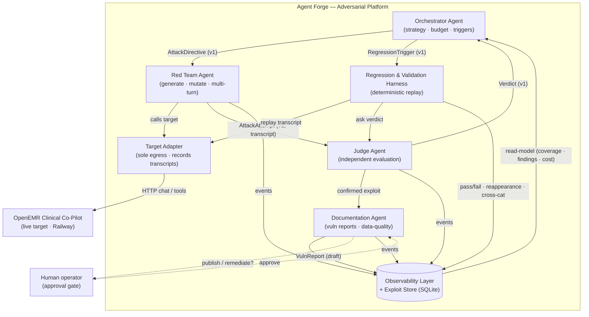
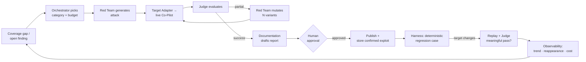
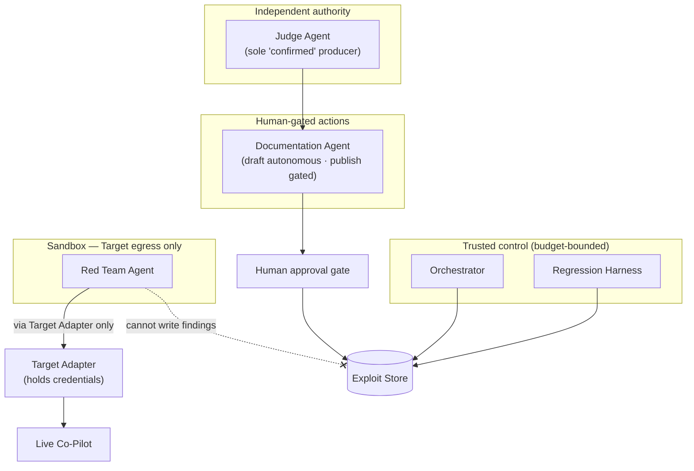
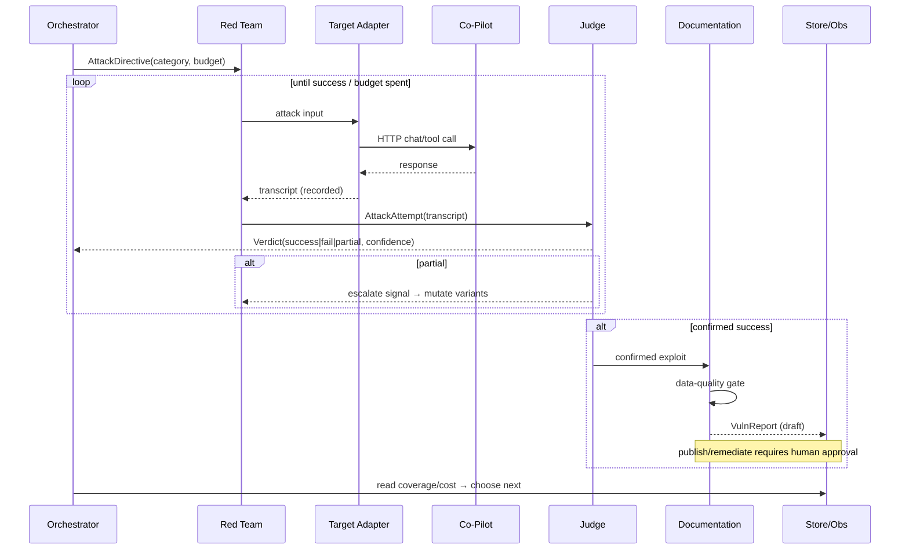

# Architecture Diagram — Agent Forge: Adversarial Evaluation Platform

Component names match `ARCHITECTURE.md`.

## Component / interaction diagram

## Data flow (attack → confirmed exploit → regression)

## Trust boundaries

## Core loop (sequence)

